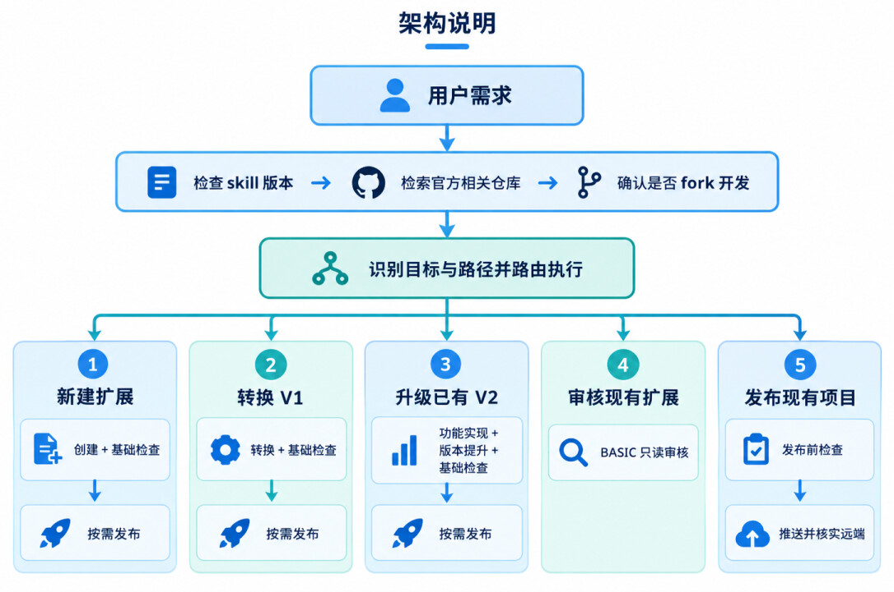

# MindPlus Extension Skills

Mind+扩展库用着不顺手？需要新的功能？试试这个skill也能体验一把开发的快乐！

## 支持的功能

| 功能 | 内容 |
| --- | --- |
| 创建 V2 扩展 | 从需求整理规格，准备最新稳定版 Builder 脚手架，生成配置、积木、代码生成器、资源和说明 |
| V1 → V2 转换 | 分析一个 V1 扩展及所选模式，保留有依据的身份、参数、依赖和行为，转换到新的 V2 目录 |
| 官方仓库发现 | 检查 mind-plus 官方组织中与当前对话相关的仓库，确认开发来源 |
| 已有 V2 升级 | 实现功能并提升扩展版本；非本人仓库使用个人令牌 fork 并核验后修改 |
| 基础检查 | 配置、资源引用、本地化、生成器映射、明显语义问题和项目说明等 |
| Gitee 发布 | 发布到已有仓库，或按授权创建仓库；检查文件集合、敏感信息、提交树、推送和远端引用；成功后自动添加仓库 Topic `MindPlus-Ext2` |
| 组合任务 | 创建后发布、转换后发布、升级后发布、审核后发布；只串联本次要求的步骤 |

## 架构说明



- **按需加载**：入口只负责路由，选中哪个流程才读取对应资料，避免一次加载全部说明。
- **脚本处理重复工作**：路由、哈希、结果交接、静态检查和发布步骤由脚本处理；扩展行为和代码实现由 Agent 根据需求与来源判断。
- **减少重复审核**：创建、转换和升级已经包含基础检查，不自动追加独立审核。已有检查在内容、范围和环境仍适用时可以复用。
- **区分完成程度**：静态检查、构建、Mind+ 使用和硬件验证分别记录。推送成功不代表已在设备上验证。
- **支持中断恢复**：运行记录保存当前流程和结果，通过 `resume` 恢复；相同 run ID 不能被另一个请求覆盖。

## 常用任务怎么提

| 目标 | 提示词示例 |
| --- | --- |
| 新建 | “使用 mindplus-extension-skills，为这个库创建 V2 扩展，先确认积木功能，输出到一个新目录。” |
| 转换 | “将这里的 V1 转换为 V2，保留默认行为，只做基础检查。” |
| 升级 | “为这个已有 V2 增加指定功能，保留原有行为，提升版本并做基础检查；非本人仓库先 fork。” |
| 普通审核 | “用 BASIC 审核这个扩展，列出具体问题，不修改文件。” |
| 创建后发布 | “完成创建和基础检查后，提交并推送到我指定的 Gitee 仓库。” |
| 独立发布 | “将当前项目提交并推送到指定仓库和分支，不追加完整 Mind+ 验收。” |
| 完整验收 | “对这个扩展执行 HOST_READY 验收，列出需要我在 Mind+ 中确认的项目。” |

> 创建／转换请提供来源和新的输出目录；发布请给出明确目标和提交／推送授权

fork 和本 skill 的发布流程需要本地个人令牌，即使 Git 使用 SSH 也不跳过发布前的令牌检查。Windows 本机推荐使用 Windows 凭据管理器：

1. 打开「控制面板 → 用户帐户 → 凭据管理器 → Windows 凭据」，添加普通凭据。
2. Internet 地址填 `git:https://gitee.com`。
3. 用户名填 Gitee 登录名，密码填 Gitee 个人访问令牌（PAT）。密码字段不会被 skill 输出或写入仓库。

skill 通过 Git Credential Manager 执行 `git credential fill` 读取该凭据；请确认 Git 配置包含 `credential.helper=manager` 或 `manager-core`。令牌只在当前进程内存中用于 Gitee API 和 HTTPS Git 认证。

环境变量 `GITEE_TOKEN` / `GITEE_ACCESS_TOKEN` 仅作为显式 CI／测试覆盖；非 Windows 主机还支持用户目录下的单行 `.gitee-token`。Gitee Go 发布工作流中的 `MP_RELEASE_TOKEN` 是平台密文变量，与本机凭据管理器分开。

**不要将 token 放进聊天、仓库、URL 或命令参数，创建扩展本身不要求 Gitee token。**

新建库作者优先使用用户指定名，否则从当前登录账号、Git 或电脑用户名选取并转换为英文署名；无特别要求不使用 DFRobot、MindPlus；已有库保留原作者。

## 安装方法

### Codex

安装位置按客户端配置选择，以下目录分别相对于用户主目录或项目根目录：

| 范围 | 相对安装目录 |
| --- | --- |
| 用户级，跨项目使用 | `.codex/skills/mindplus-extension-skills/` |
| 项目级，随项目共享 | `.codex/skills/mindplus-extension-skills/` |

在选定的安装基目录中执行：

```powershell
New-Item -ItemType Directory -Force ".codex/skills" | Out-Null
git clone https://gitee.com/mind-plus/mindplus-extension-skills.git ".codex/skills/mindplus-extension-skills"
```

如果目标已存在，不必再次 clone。安装后查看技能列表；CLI / IDE 可用 `/skills`，并通过 `$` 选择技能：

```text
$mindplus-extension-skills 帮我把 extensions/v1-demo 转换到 extensions/v2-demo，只做转换和基础检查。
```

桌面端也可在技能界面选择后补充任务。未识别时重开会话或重启客户端。已有版本若使用其他技能目录，应以该客户端显示的实际来源为准，避免重复安装同名副本。见 [Codex 官方技能文档](https://learn.chatgpt.com/docs/build-skills)。

### Claude Code

将整个目录放到用户主目录或项目根目录下的 `.claude/skills/mindplus-extension-skills/`。

在选定的安装基目录中执行：

```powershell
New-Item -ItemType Directory -Force ".claude/skills" | Out-Null
git clone https://gitee.com/mind-plus/mindplus-extension-skills.git ".claude/skills/mindplus-extension-skills"
```

在 Claude Code 中调用：

```text
/mindplus-extension-skills 审核 extensions/v2-demo，使用 BASIC，只报告问题和建议。
```

也可通过自然语言明确要求使用该技能。若会话启动时尚不存在技能父目录，安装后重启会话。见 [Claude Code 官方技能文档](https://code.claude.com/docs/en/skills)。

### WorkBuddy

可在以下方法二选一：

- （推荐）直接在技能市场搜索 `Mind+ 扩展开发助手`即可下载使用

- 使用本地技能包导入入口：

1. 从 [发行版](https://gitee.com/mind-plus/mindplus-extension-skills/releases/) 下载名称含 `workbuddy` 的 ZIP，保留完整包内容。
2. 打开 **技能 → 添加技能 → 上传技能**，选择本地技能包并导入。
3. 在已安装列表中确认 `mindplus-extension-skills` 已启用，并让任务可以访问扩展所在目录。
4. 在对话中明确说明：

```text
请使用 mindplus-extension-skills，为这个传感器创建 Mind+ V2 上传模式扩展。
需求和库源码在 extensions/sensor-source，输出到 extensions/sensor-v2。
先整理规格并完成创建和基础检查，不发布。
```

### ZCode

用户主目录下的相对安装目录为 `.zcode/skills/mindplus-extension-skills/`。在用户主目录中执行：

```powershell
New-Item -ItemType Directory -Force ".zcode/skills" | Out-Null
git clone https://gitee.com/mind-plus/mindplus-extension-skills.git ".zcode/skills/mindplus-extension-skills"
```

安装后进入 **设置 → 技能 → 刷新**，确认已启用；在对话中输入 `$` 选择：

```text
$mindplus-extension-skills 检查 extensions/v2-demo 的配置和资源引用，使用 BASIC。
```

如果已在 Codex 或 Claude Code 安装，也可以从 ZCode 的 **设置 → 技能 → 导入** 扫描外部技能，并选择复制或软链接；复制为独立副本，软链接需要来源目录持续可用。见 [ZCode 官方技能文档](https://zcode.z.ai/cn/docs/skill)。

### Others：其他 Agent

支持 Agent Skills 目录的工具，可以按其文档将完整目录放入技能搜索路径；不同工具的目录和调用符号可能不同，不要默认都使用 `.claude/skills` 或 `$`。

没有原生 Skill 功能，但能读文件和执行命令的工具，可以把仓库放在可访问的位置，在任务开始时明确指定入口：

```text
请先完整读取 tools/mindplus-extension-skills/SKILL.md，
以该目录为技能根目录，按路由只加载本次需要的参考文件，
使用其 scripts 中的工具完成任务。

本次目标：将 extensions/v1-demo 转换到 extensions/v2-demo。
只转换和基础检查，不发布，不做 HOST_READY 验收。
```

也可以在该工具支持的项目指令文件中保留这段入口提示。只支持聊天、无法访问技能目录或运行脚本的工具，可以讨论方案，但不能直接执行本项目的完整流程。

## 目录导览

| 路径 | 用途 |
| --- | --- |
| [SKILL.md](SKILL.md) | Agent 入口、路由和主要边界 |
| [scripts/mpa.py](scripts/mpa.py) | 启动、交接、推进、恢复与清理 |
| [references/workflows/](references/workflows/) | 五个叶流程及按需加载的完整验收说明 |
| [references/switch/](references/switch/) | 创建和转换共用的模式、规范和参考资料 |
| [references/contracts/](references/contracts/) | 请求、规格和 handoff 的数据结构 |
| [scripts/switch/](scripts/switch/) | 来源分析、脚手架和静态检查工具 |
| [agents/openai.yaml](agents/openai.yaml) | Codex 展示和调用元数据 |
| [tests/](tests/) | 路由、校验、发布及回归测试 |

进一步了解实现约定，可阅读 [架构说明](references/architecture.md)、[证据与审核等级](references/evidence.md) 和 [结果交接协议](references/handoff.md)。

自更新会按安装布局选择 ZIP，并核对同名 `.zip.sha256` 文件；下载或校验失败不会安装。Release 的通用源码包保留原目录结构。

## 版本更新

- V0.3.0
   - 脚手架默认选择最新稳定 Release，兼容 ZIP 根目录与单层包装目录
   - 完善全局规范并提升至V3稳定版

- V0.2.4
   - 补充积木设计与下拉合并规范

- V0.2.3
   - Release 提供 WorkBuddy、通用源码两个 ZIP 及各自 SHA-256 校验文件
   - 自更新下载后先校验摘要，再解压安装；校验缺失或失败时保留原版本

- V0.2.2
   - 新建和 V1 转换项目目录统一校验 `ext2-` 前缀
   - 增加 cover/banner 规范，区分实物与非实物扩展的构图和文字要求

- V0.2.1
   - 发布扩展时自动添加并核验仓库 Topic `MindPlus-Ext2`
   - 审核使用P0/P1/P2三级分类处理
   - 修改名称为 MindPlus-Extension-Skills

- V0.2.0
   - 推送正式版

- V0.1.4
   - 新增已有 V2 升级、扩展版本提升及个人令牌 fork 开发流程。
   - 版本检查后发现官方相关仓库，询问是否基于已有仓库开发。
   - 纳入版本检查与更新修复，补充官方仓库检索完整性检查。

- V0.1.3
   - 更改推荐个人令牌读取方式

- V0.1.2
   - 内置 WB 打包工具与发布配置，添加 Gitee Go 标签发布工作流
   - 自动生成 WB ZIP、核对附件内容并维护发行版下载说明

- V0.1.1
   - 添加自动更新逻辑
   - 修复 V1 转 V2 中关于 string 的处理

- V0.1.0
   - 初始化第一个版本
